<p align="center">
  
</p>

<h1 align="center">Boxset</h1>

<p align="center">
  <strong>Your movie collection on one Blu-ray, with a menu made for it.</strong><br>
  Add your movies, pick a theme, press Build. Boxset does the rest.
</p>

<p align="center">
  <a href="https://github.com/RamenNuudlss/Boxset/releases/latest"></a>
  <a href="https://github.com/RamenNuudlss/Boxset/actions/workflows/build.yml"></a>
  
  
</p>

<p align="center">
  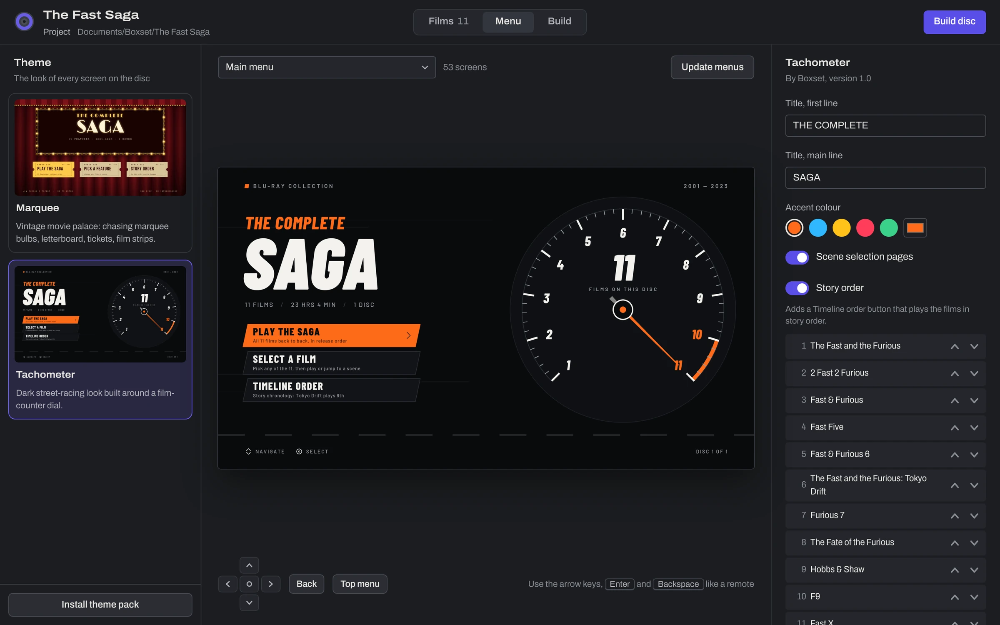
</p>

Boxset turns a folder of movie files into a Blu-ray disc with a real, themed menu: a main
menu, a film list, a page for every film and scene selection built from each film's own
chapters. It works out how to fit every film on the disc at the best quality that fits,
renders every menu screen, encodes the films, and writes a disc that plays in an ordinary
Blu-ray player, remote and all.

---

## Contents

- [Highlights](#highlights)
- [What you need](#what-you-need)
- [Install](#install)
- [Quick start](#quick-start)
- [Using Boxset](#using-boxset)
  - [Films](#1-films)
  - [Disc space and picture quality](#disc-space-and-picture-quality)
  - [Menu](#2-menu)
  - [Build](#3-build)
  - [Burning and testing](#burning-and-testing)
  - [Projects and where files go](#projects-and-where-files-go)
- [Themes](#themes)
- [What's on the finished disc](#whats-on-the-finished-disc)
- [Supported files and limits](#supported-files-and-limits)
- [Command line](#command-line)
- [Project file reference](#project-file-reference)
- [Troubleshooting](#troubleshooting)
- [How it works](#how-it-works)
- [Building from source](#building-from-source)
- [Credits and licences](#credits-and-licences)

---

## Highlights

- **Drop in your movies.** Files or whole folders. Title and year are read from the file
  name (`Fast.Five.2011.1080p.BluRay.mkv` becomes *Fast Five*, 2011), and each film's
  length, chapters and audio are read from the file itself.
- **See the fit before you build.** A live disc diagram shows each film's share of the
  disc and the picture quality your chosen disc size allows.
- **Menus with character.** Themes decide every screen, button and transition. Two
  are built in, and new ones install with a double-click.
- **Click through the real menus first.** The menu preview is the actual rendered disc
  menu, driven with the arrow keys exactly as your remote will drive it.
- **One button to build.** Menus, encoding, the disc structure and a disc image, with
  live progress and a time estimate. Stop whenever you like; finished films are kept.
- **Plays in standard players.** Menus use the standard Blu-ray menu system (HDMV), not
  Java, and every menu is checked against Blu-ray rules before anything is built.
- **Nothing extra to install.** FFmpeg is bundled, and disc images and burning use
  Windows' own tools.

<p align="center">
  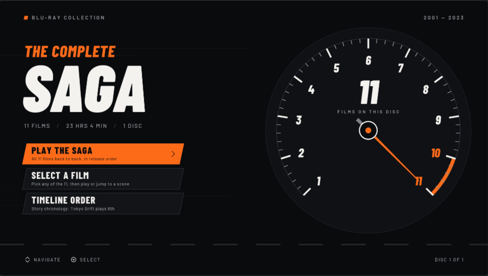
  <br><sub>The menu preview, driven with the arrow keys and Enter like a remote.</sub>
</p>

## What you need

| Need | Details |
|---|---|
| **Computer** | Windows 10 or 11, 64-bit. A recent multi-core processor makes encoding much faster. |
| **Your movies** | Video files you already have: MKV, MP4, M4V, MOV, AVI, M2TS, TS, WMV, WebM, VOB or MPG. Boxset doesn't rip or decrypt discs. |
| **Free disk space** | Roughly the size of the disc you're making, plus the same again if you also make a disc image (see [disk space](#disk-space)). |
| **To burn** | A Blu-ray burner and blank discs: BD-R / BD-RE for 25 and 50 GB, BD-R XL for 100 GB. |
| **To watch** | Any standard Blu-ray player. 100 GB discs need a player that supports BDXL. |

Microsoft Edge WebView2, which draws the app's window, is built into Windows 11 and most
up-to-date Windows 10 PCs. The installer adds it if it's missing.

## Install

1. Download **`BoxsetSetup-<version>.exe`** from the
   [latest release](https://github.com/RamenNuudlss/Boxset/releases/latest).
2. Run it. The installer isn't code-signed yet, so Windows SmartScreen may say *Windows
   protected your PC*. Choose **More info → Run anyway**.
3. Open **Boxset** from the Start menu.

The installer also sets up file types: double-clicking a `.boxset` project opens it in
Boxset, and double-clicking a `.boxtheme` theme pack installs it. Uninstall from
**Settings → Apps**; your projects in Documents are left alone.

## Quick start

1. **Films.** Drop your movie files (or a folder of them) into the window. Fix any titles
   that need it and drag the films into the order you want on the disc.
2. **Menu.** Pick a theme, set its options (title, colours, story order), and press
   **Render menus**. Click through the result with the arrow keys and Enter.
3. **Build.** Press **Build disc** and leave Boxset running. When it's done, press
   **Burn to disc**, or use the disc folder or image however you like.

Burn your first disc to a rewritable BD-RE and try it in your player before using
write-once discs.

---

## Using Boxset

The window has three tabs, one per step: **Films**, **Menu** and **Build**. Everything you
change is saved automatically.

### 1. Films

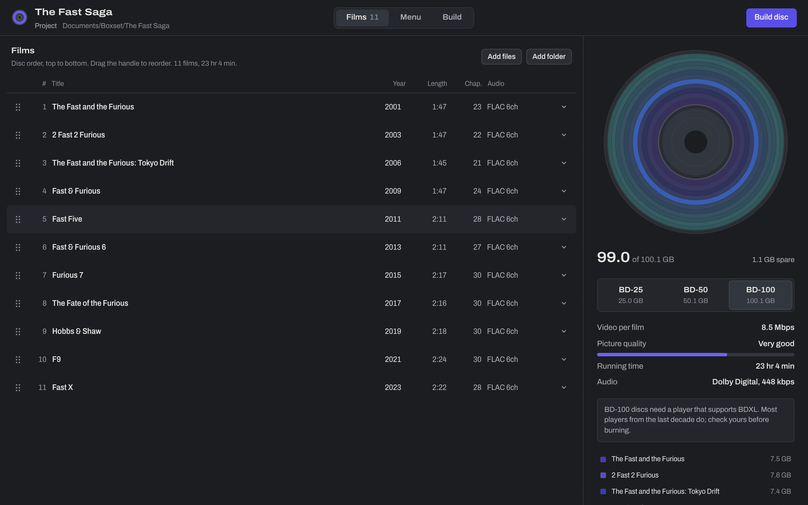

**Adding films.** Drag files or folders from File Explorer into the window, or use **Add
files** / **Add folder**. A folder adds the video files inside it (not its subfolders).
The same file can't be added twice.

**Titles and years.** Boxset reads them from the file name, ignoring the usual release
tags:

| File name | Title | Year |
|---|---|---|
| `The.Fast.and.the.Furious.2001.1080p.BluRay.x264.mkv` | The Fast and the Furious | 2001 |
| `2 Fast 2 Furious (2003).mkv` | 2 Fast 2 Furious | 2003 |
| `Fast Five (2011) [1080p] REMUX.mkv` | Fast Five | 2011 |
| `Blade.Runner.2049.2017.2160p.UHD.mkv` | Blade Runner 2049 | 2017 |
| `1917.2019.1080p.mkv` | 1917 | 2019 |

Click any title or year to edit it. Press Enter or click away to save.

**Order.** New films are sorted by year, which is release order for most collections.
Drag the handle at the left of a row to set your own order. Once you've reordered by
hand, Boxset stops sorting.

**Film details.** The arrow at the end of a row opens more:

- **Setting or tagline**, shown on the film's page by some themes (the Tachometer theme
  shows it as the film's location).
- **Mark as a spin-off**, which themes can label (both built-in themes do).
- Any extra fields the current theme asks for.
- The file's location, resolution, frame rate and size, plus **Remove from disc**.

**Status.** While a file is being read, its row shows *Reading…*. A dot at the end of a
row means something needs attention:

| Dot | Meaning | Examples |
|---|---|---|
| Amber | Boxset will handle it, but you should know | 24 fps is converted to 23.976 fps; a file with no audio gets silence |
| Red | This file can't go on the disc as it is; the build is blocked until it's removed | an unsupported frame rate such as 30, 50 or 60 fps; a file that can't be read |

### Disc space and picture quality

The disc on the right of the Films tab is drawn to scale. Data is written from the
centre outwards, so each film is a ring whose area matches its share of the disc. Hover
over a film to highlight its ring.

Pick the disc type underneath: **BD-25**, **BD-50** or **BD-100**. Boxset then shares the
disc between your films:

1. 1.5 GB is set aside for menus and the file system.
2. About 5% goes to the Blu-ray stream format itself.
3. Every film gets 448 kbps Dolby Digital audio.
4. Everything left becomes video, shared evenly by running time, capped at 30 Mbps.

**Video per film** and **Picture quality** show the result:

| Video per film | Shown as |
|---|---|
| 20 Mbps and up | Close to a retail disc |
| 12–20 Mbps | Excellent |
| 8–12 Mbps | Very good |
| 5–8 Mbps | Good |
| 3–5 Mbps | Fair, some softness |
| under 3 Mbps | Heavily compressed |

As a rule of thumb, this is how many hours of film fit at each quality:

| Disc | 20 Mbps | 12 Mbps | 8 Mbps | 5 Mbps |
|---|---|---|---|---|
| BD-25 | 2.4 h | 4.0 h | 5.9 h | 9.1 h |
| BD-50 | 5.0 h | 8.3 h | 12.2 h | 18.9 h |
| BD-100 | 10.2 h | 16.8 h | 24.7 h | 38.3 h |

The 11-film collection in the screenshots is 23 hours long: about 1.7 Mbps on a BD-25,
4.0 Mbps on a BD-50 and 8.5 Mbps on a BD-100. The estimate is a ceiling, since simple
scenes use less than their share, so finished discs usually come out a little smaller.

### 2. Menu

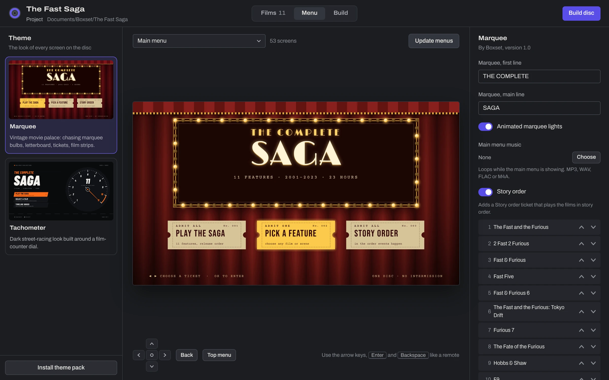

**Theme.** The list on the left shows every installed theme with a preview. A theme
that's meant for a different number of films says so on its card.

**Settings.** The panel on the right shows the selected theme's own settings: titles,
colours, switches, music, and a **Story order** for collections whose story runs in a
different order from their release order. Settings are saved per project.

**Render menus.** Builds every screen from your actual films and chapters, including a
frame from every chapter for scene selection. An 11-film collection makes around 50
screens and takes a minute or two. Afterwards **Changed since last render** appears
whenever you edit something the menus depend on; press **Update menus** to bring them up
to date. A build also does this automatically.

**Preview.** The picture in the middle is the rendered disc menu, and it behaves like the
disc:

| Key | Remote button |
|---|---|
| Arrow keys | Up, down, left, right |
| Enter | OK |
| Backspace or Esc | Back (previous menu) |
| Home | Top Menu |

You can also click a button directly, or jump to any screen with the drop-down above the
picture. Choosing something that plays a film shows a card saying what would play and
which menu the player returns to afterwards. **Finish film** takes you there.

### 3. Build

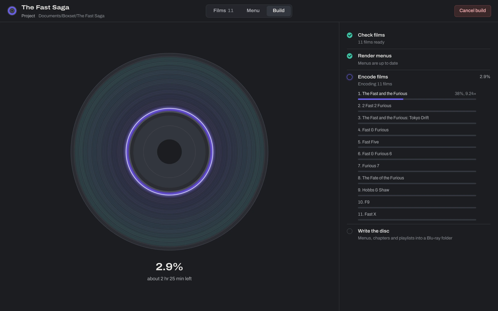

**Build disc** (on this tab, or at the top right of any tab) runs everything:

| Step | What happens | Time |
|---|---|---|
| Check films | Re-reads every file and plans the disc space | Seconds |
| Render menus | Renders the menus, or skips this if nothing changed | Up to a few minutes |
| Encode films | Converts each film to Blu-ray video and audio | The long part (see below) |
| Write the disc | Builds the Blu-ray folder: menus, chapters, playlists | A minute or two |
| Disc image | Optional: one `.iso` file ready to burn (Windows) | A few minutes |

**Options** (on the Build tab, before you start):

- **Also make a disc image (.iso) for burning.** On by default.
- **Quick test build, low quality.** Encodes much faster at much lower quality. Use it to
  check menus and navigation on a real player before committing to a full build.

**How long encoding takes.** It depends almost entirely on your processor. A modern
desktop encodes 1080p faster than real time; an older laptop may be slower than real
time. Boxset shows the speed (for example *1.8×*) and a time estimate once a film has
started.

**Stopping and resuming.** **Cancel build** stops straight away. Films that finished are
kept, and the next build picks up from the first unfinished film.

**What makes Boxset encode a film again:**

| Change | Re-encodes? |
|---|---|
| Editing titles, years or other details | No |
| Reordering films | No |
| Changing the theme or any theme setting | No (menus only) |
| Replacing a film's file, or editing the file | That film |
| Adding or removing films, or changing the disc size | Usually all of them, because each film's share of the disc changes |
| Switching between quick test and full quality | All of them |

When the build finishes, the Build tab offers **Show disc folder**, **Make disc image**
(if you didn't make one) and **Burn to disc**.

### Burning and testing

**Burn to disc** opens the image in **Windows Disc Image Burner**, which comes with
Windows. Choose your burner, tick *Verify disc after burning* if you like, and press
**Burn**.

The disc folder (`build\disc`, containing `BDMV`) also works with other tools:

- **ImgBurn**: *Write files/folders to disc*, choosing the `disc` folder, or *Write image
  file to disc* with the `.iso`.
- **Playing on your PC**: open the `.iso` or the `disc` folder in a Blu-ray player app.
  VLC's support for Blu-ray menus is limited, so a menu that misbehaves there may still
  be fine on a real player.

The first time, burn to a **BD-RE** (rewritable) disc and try every menu on your actual
player. Each player model can differ slightly, so if a menu misbehaves on yours, please
[report it](https://github.com/RamenNuudlss/Boxset/issues/new/choose) with the player's
make and model.

### Projects and where files go

Each collection is a project. The first film you add saves a new project to
`Documents\Boxset\<collection name>\`, and every change after that saves on its own.
Rename the collection by clicking its name at the top left. The **Project** menu next to
it has **New collection**, **Open project…**, **Save project as…**, **Show project
folder** and your recent projects.

```
Documents\Boxset\The Fast Saga\
├─ The Fast Saga.boxset         the project (films, theme, settings)
└─ build\
   ├─ disc\BDMV\...             the finished disc, ready to burn
   ├─ THE_FAST_SAGA.iso         the disc image, if you made one
   ├─ clips\                    encoded films, kept so rebuilds are quick
   ├─ menus\                    rendered menu screens and buttons
   └─ thumbs\                   chapter frames for scene selection
```

Your original movie files are never changed or moved.

Other locations:

| What | Where |
|---|---|
| App settings and recent projects | `%APPDATA%\Boxset\settings.json` |
| Installed theme packs | `%APPDATA%\Boxset\themes\` |
| The app itself | `C:\Program Files\Boxset\` |

#### Disk space

The encoded films in `build\clips` and the finished disc in `build\disc` share the same
data, so a build needs about **one disc's worth** of free space on the drive holding the
project. A disc image adds **another disc's worth**. On drives formatted as exFAT or FAT32
the films and disc can't share data, which adds one more. When you're done with a
collection, you can delete its `build` folder; the project file is all you need to build
it again.

---

## Themes

A theme decides everything you see on the disc: how many screens there are, what's on
them, how the buttons look in each state, and where every button leads. Boxset comes
with two.

### Tachometer

Night-street racing. A dial numbered 1 to N counts the films; each film's page swings the
needle to its number and shows where it sits in the series.

| Main menu | Film list |
|---|---|
|  | 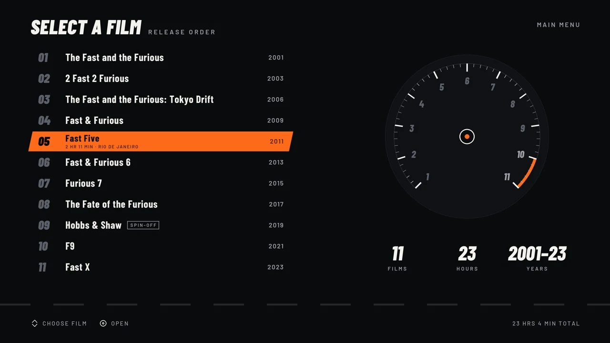 |
| **Film page** | **Scene selection** |
| 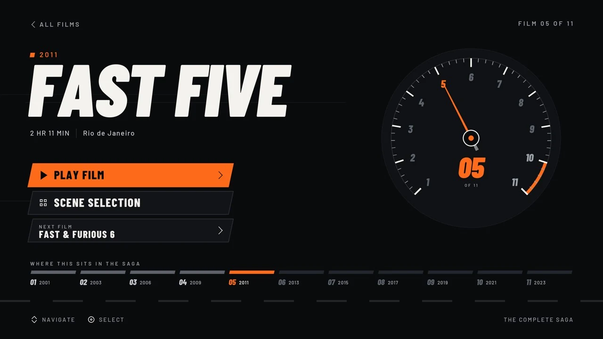 | 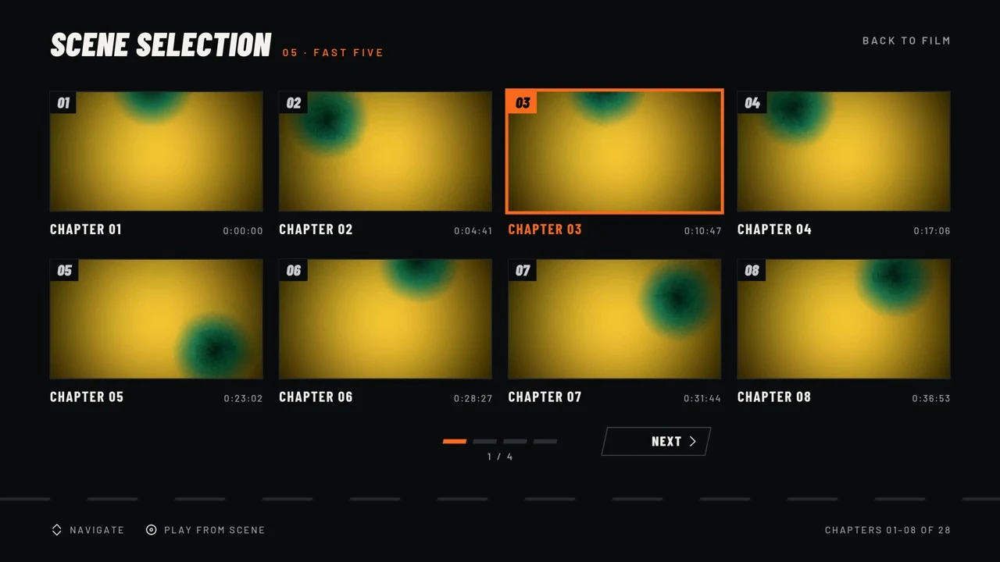 |

**Settings:** both title lines, accent colour (five presets or any colour), scene
selection on or off, and story order, which adds a *Timeline order* button.
**Fits:** 2 to 12 films.

### Marquee

An old movie palace: velvet curtains, a marquee with chasing bulbs (a looping video
background), a letterboard film list, admission-ticket film pages and 35 mm film-strip
scene selection.

<p align="center">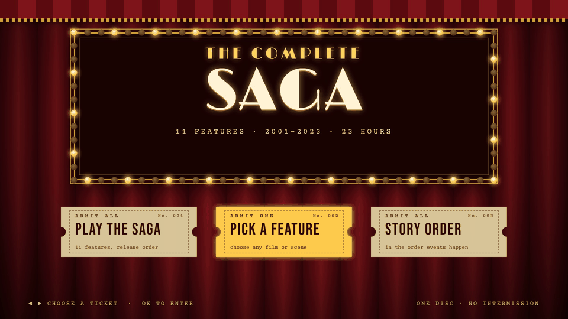</p>

| Film list | Film page | Scene selection |
|---|---|---|
| 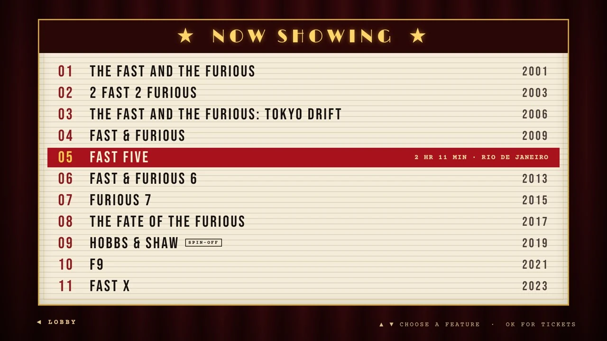 | 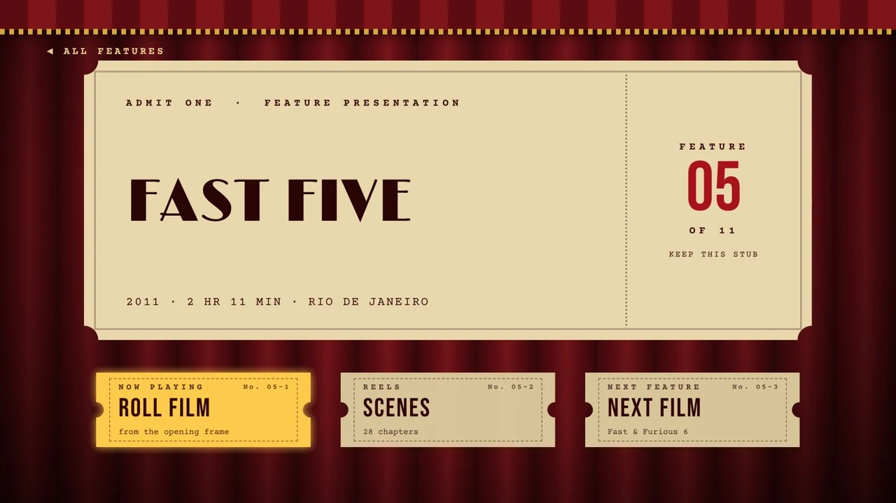 | 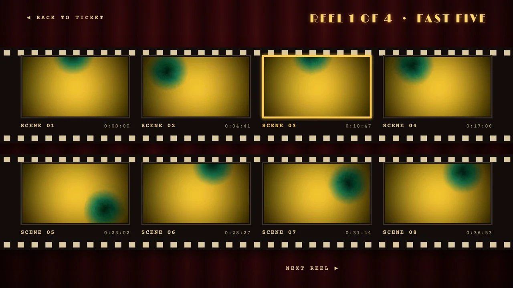 |

**Settings:** both marquee lines, animated lights on or off, main menu music (MP3, WAV,
FLAC or M4A, looped), and story order, which adds a *Story order* ticket.
**Fits:** 1 to 11 films.

The chapter frames in these screenshots are abstract stand-ins. On your disc they're
frames from your own films.

### Installing theme packs

Themes are shared as `.boxtheme` files. Double-click one, or use **Install theme pack**
at the bottom of the Menu tab's theme list. Installed packs appear in the list straight
away and are kept in `%APPDATA%\Boxset\themes\`.

> [!WARNING]
> A theme pack contains program code that runs on your PC when menus are rendered.
> Only install theme packs from people you trust.

### Making your own

Themes are written in Python, drawing screens either with code or as ordinary web pages
in HTML and CSS, so a menu can look like anything a web page can. Boxset supplies the
films, chapters and frame grabs, and checks the result against Blu-ray menu rules
before anything is built. The full guide is in **[THEMES.md](THEMES.md)**.

---

## What's on the finished disc

- **Inserting the disc** goes straight to the theme's main menu. There are no warnings or
  logos first. The remote's **Top Menu** button returns there from anywhere.
- **Every film** is its own title, with all of its original chapters, so the remote's
  chapter skip works during playback.
- **Playlists** that the theme defines, such as *play all in release order* or *story
  order*, play several films back to back.
- **When a film ends**, the player goes wherever the theme says. Both built-in themes go
  back to that film's page.
- **Video** is H.264 High profile at level 4.1, the standard Blu-ray format, at
  1920 × 1080. Every chapter starts on a key frame, so chapter jumps are instant.
- **Audio** is each film's first audio track as Dolby Digital: 5.1 at 448 kbps when the
  source has 5.1 or more, otherwise stereo at 192 kbps.
- **Menus** use HDMV interactive graphics, the menu system every Blu-ray player supports.
  Backgrounds can be still pictures or looping video, with optional music.

## Supported files and limits

| | Supported | Notes |
|---|---|---|
| **File types** | MKV, MP4, M4V, MOV, AVI, M2TS, TS, WMV, WebM, VOB, MPG/MPEG | Anything FFmpeg can read, with one of the extensions on the left |
| **Frame rates** | 23.976, 24, 25, 29.97 fps | 24 fps becomes 23.976 (an occasional frame is dropped). 25 and 29.97 fps are stored the way Blu-ray requires (as 1080i). 30, 50, 59.94 and 60 fps aren't supported |
| **Resolution** | Anything | Scaled to fit 1920 × 1080, with black bars to keep the shape |
| **4K and HDR** | Scaled down to 1080p | HDR colour (HDR10, Dolby Vision) isn't converted and will look washed out. Use SDR (standard) versions of your films |
| **Audio** | The first audio track | Other tracks (other languages, commentaries) aren't included |
| **Subtitles** | Not yet | Subtitles in your files aren't carried onto the disc |
| **Chapters** | From the file | Files without chapters get a single chapter, and scene selection is skipped for them. Chapters closer than 5 seconds together are merged |
| **Disc types** | BD-25, BD-50, BD-100 | Single-disc collections only |
| **Films per disc** | Set by the theme | Tachometer 2–12, Marquee 1–11 |

**Rules every menu follows**, because players require them (Boxset checks these for
every theme):

- Buttons can't overlap, including any glow around them.
- Every button must be fully on screen.
- A menu can have at most 255 buttons.
- Button graphics use at most 256 colours per menu. Boxset reduces them automatically, so
  themes keep gradients and photos in the background, which has full colour.
- Every button must lead somewhere that exists.

---

## Command line

The installer includes `boxset-cli.exe` next to `Boxset.exe`. It does the same work
without the window, using a `.boxset` project made in the app. It isn't added to `PATH`,
so run it by its full path:

```powershell
& "C:\Program Files\Boxset\boxset-cli.exe" build "$env:USERPROFILE\Documents\Boxset\The Fast Saga\The Fast Saga.boxset"
```

| Command | What it does |
|---|---|
| `boxset-cli check <project>` | Reads every film and prints its length, frame rate, chapters and audio, the disc-space plan, and anything that needs fixing |
| `boxset-cli themes <project>` | Lists the available themes (`*` marks the project's) |
| `boxset-cli menus <project>` | Renders every menu screen and checks them against Blu-ray rules |
| `boxset-cli preview <project>` | Saves `build\menus_preview.jpg`, a contact sheet of every screen |
| `boxset-cli build <project>` | Runs the whole build |

| Option | For | Effect |
|---|---|---|
| `--theme NAME` | `menus` | Try another theme without changing the project |
| `--force` | `menus` | Render again even if nothing changed |
| `--iso` | `build` | Also make a disc image (Windows) |
| `--fast` | `build` | Quick, low-quality test build |
| `--skip-encode` | `build` | Rebuild the disc from films that are already encoded |
| `--refresh` | `check` | Re-read every file instead of using what's remembered |

`Boxset.exe <project>` opens a project in the app, and `Boxset.exe <file>.boxtheme`
installs a theme pack.

## Project file reference

A `.boxset` file is plain JSON, so you can edit it by hand or generate it with a script.
Paths can be absolute or relative to the project file.

```json
{
  "name": "The Fast Saga",
  "disc_label": "THE_FAST_SAGA",
  "disc_size": "BD-100",
  "audio_kbps": 448,
  "theme": "tachometer",
  "theme_options": {
    "title_small": "THE COMPLETE",
    "title_big": "SAGA",
    "accent": "#FF6B1A",
    "scene_selection": true,
    "timeline_order": [1, 2, 4, 5, 6, 3, 7, 8, 9, 10, 11]
  },
  "build_dir": "build",
  "films": [
    {"file": "D:/Rips/Fast Five (2011).mkv", "title": "Fast Five", "year": 2011, "place": "Rio de Janeiro"},
    {"file": "D:/Rips/Hobbs.and.Shaw.2019.mkv", "title": "Hobbs & Shaw", "year": 2019, "spinoff": true}
  ]
}
```

| Key | Meaning |
|---|---|
| `name` | The collection's name in the app |
| `disc_label` | The disc's volume name: up to 32 letters, digits and underscores. Follows the name unless you set it |
| `disc_size` | `BD-25`, `BD-50` or `BD-100` |
| `audio_kbps` | Dolby Digital bitrate for 5.1 audio (default 448) |
| `theme` | The theme's folder name, as listed by `boxset-cli themes` |
| `theme_options` | The theme's settings (see each theme). `timeline_order` lists film numbers in story order |
| `build_dir` | Where build output goes, relative to the project file |
| `films` | In disc order. `file` and `title` are required; `year`, `place` and `spinoff` are optional, and themes may read extra keys |

## Troubleshooting

<details>
<summary><strong>Windows says "Windows protected your PC" when I run the installer</strong></summary>

The installer isn't code-signed yet, so SmartScreen doesn't recognise it. Choose **More
info → Run anyway**. Only do this with an installer downloaded from this repository's
Releases page.
</details>

<details>
<summary><strong>The app window is blank or won't open</strong></summary>

Boxset's window needs Microsoft Edge WebView2. The installer adds it when it's missing,
but if that was skipped, install the *Evergreen Runtime* from
[Microsoft](https://developer.microsoft.com/microsoft-edge/webview2/) and open Boxset
again. As a fallback, `boxset-cli.exe gui --browser` opens the same app in your web
browser.
</details>

<details>
<summary><strong>A film shows a red dot or "Can't use"</strong></summary>

Open the film's details (the arrow at the end of its row) to see the reason. Usually it's
a frame rate a Blu-ray can't hold (30, 50 or 60 fps), or a damaged or incomplete file.
Convert the file to 23.976 or 29.97 fps with another tool, or remove it from the
project.
</details>

<details>
<summary><strong>The picture looks washed out or grey</strong></summary>

The source is HDR (often 4K releases). Boxset makes standard 1080p Blu-rays and doesn't
convert HDR colour. Use the SDR version of the film.
</details>

<details>
<summary><strong>My subtitles or second audio track are missing</strong></summary>

Boxset currently carries each film's first audio track only, and no subtitles. If the
language you want isn't the first track, reorder the tracks in your file (for example
with MKVToolNix) so it comes first.
</details>

<details>
<summary><strong>The menu doesn't appear, or a button does nothing, on my player</strong></summary>

Try the disc in a Blu-ray player app on your PC to see whether it's the disc or the
player. Make a **Quick test build** and burn it to a BD-RE, so you can test changes
cheaply. Then please [open an issue](https://github.com/RamenNuudlss/Boxset/issues/new/choose)
with your player's make and model, the theme, and what happens. Player behaviour varies,
and reports are how Boxset gets better at it.
</details>

<details>
<summary><strong>My player won't read a BD-100 disc</strong></summary>

100 GB discs are BDXL, which older players don't support. Use a BD-50 (Boxset will lower
the bitrate to fit), or split the collection into two projects.
</details>

<details>
<summary><strong>Encoding is very slow</strong></summary>

Encoding is processor-heavy. Close other demanding programs, and leave the PC plugged in
and awake. You can cancel and continue later without losing finished films. To check
menus quickly first, use **Quick test build**.
</details>

<details>
<summary><strong>The build stopped with a disk space error</strong></summary>

Free up space on the drive holding the project (see [disk space](#disk-space)), or move
the project folder to a bigger drive and open it from there, then build again. Finished
films are kept.
</details>

<details>
<summary><strong>Making the disc image failed</strong></summary>

The disc folder is still complete. Burn `build\disc` with ImgBurn's *Write files/folders
to disc*, or try **Make disc image** again from the Build tab. The *Details* section on
the Build tab shows the error message.
</details>

<details>
<summary><strong>My antivirus flagged Boxset</strong></summary>

Unsigned apps packaged with PyInstaller occasionally trigger false positives. The
installer is built by GitHub Actions from the code in this repository, and you can follow
every build under [Actions](https://github.com/RamenNuudlss/Boxset/actions). If it happens,
please report it to your antivirus vendor as a false positive, and let us know in an
issue.
</details>

---

## How it works

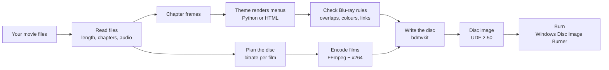

| Part | Job |
|---|---|
| `boxset/probe.py` | Reads each file with ffprobe: duration, frame rate, chapters, audio |
| `boxset/budget.py` | Shares the disc between films |
| `boxset/core.py` | The theme interface: films and chapters in; menus, buttons, actions and playlists out. Also checks every menu against Blu-ray rules |
| `boxset/html.py` | Renders HTML/CSS theme screens with Microsoft Edge (via Playwright): background, each button in three states, and looping video backgrounds |
| `boxset/pipeline.py` | The build: read, plan, render, encode (with progress and cancelling), write the disc |
| `boxset/iso.py` | Disc images with Windows' built-in disc writer (IMAPI2) |
| `boxset/gui/` | The app: a local, token-protected server and the interface, shown in an Edge WebView2 window |
| [bdmvkit](https://github.com/kajisho5/bdmvkit) | Writes the Blu-ray structure: interactive menu graphics, navigation commands, playlists and clip information |

The app only listens on `127.0.0.1`, and every request must carry a random key created
each time Boxset starts. Other programs and websites can't drive it or read your files
through it.

## Building from source

**Run from source:**

```bash
git clone https://github.com/RamenNuudlss/Boxset.git
cd Boxset
pip install -r requirements.txt
python -m boxset                  # the app
python -m boxset --browser        # the app in a browser tab
python -m boxset build "path/to/project.boxset" --fast
```

You need Python 3.11 or newer and FFmpeg on `PATH`. HTML themes use Microsoft Edge or
Chrome through Playwright. If neither is installed, run `playwright install chromium`.

**Make the installer locally** (Windows):

```powershell
pip install pyinstaller
pyinstaller --noconfirm packaging/boxset.spec       # dist\Boxset\
# put ffmpeg.exe and ffprobe.exe in dist\Boxset\bin\
& "${env:ProgramFiles(x86)}\Inno Setup 6\ISCC.exe" packaging\installer.iss
```

**Releases** are built by [GitHub Actions](.github/workflows/build.yml) on Windows: every
push to `main` makes an installer you can download from the run's page, and publishing a
release with a `v*` tag (for example `v0.1.0`) attaches `BoxsetSetup-0.1.0.exe` to it.
The workflow packages the app with PyInstaller, bundles FFmpeg, fetches the WebView2
installer, runs a quick check that the packaged app starts, and builds the installer with
Inno Setup.

**Testing a disc's navigation:** `tests/libbluray_nav.py` opens a built disc with
libbluray (the engine inside VLC, Kodi and mpv), presses remote buttons, and saves what
the player draws:

```bash
python tests/libbluray_nav.py build/disc out/ down enter enter enter
```

**Layout:**

```
boxset/            the app and engine
  themes/          built-in themes (one folder each)
  gui/             the app window: api.py, server.py, web/
  fonts/           fonts used by the built-in themes
packaging/         PyInstaller spec, installer script, icon
tests/             disc navigation test
docs/images/       screenshots for this page
THEMES.md          writing themes
```

---

## Credits and licences

Boxset is built on:

- **[FFmpeg](https://ffmpeg.org)** and **x264** for reading and encoding video
- **[bdmvkit](https://github.com/kajisho5/bdmvkit)** for the Blu-ray disc structure
- **[Pillow](https://python-pillow.org)**, **[Playwright](https://playwright.dev/python/)**
  and **[pywebview](https://pywebview.flowrl.com)**
- Fonts: Archivo, Barlow, Barlow Condensed, Bebas Neue, Courier Prime and Limelight, all
  under the SIL Open Font License

Licences for everything bundled with Boxset are listed in
[THIRD_PARTY_NOTICES.md](THIRD_PARTY_NOTICES.md). The installer includes FFmpeg under the
GPL; its source is available from [gyan.dev](https://www.gyan.dev/ffmpeg/builds/), the
build Boxset bundles.

Boxset's own licence hasn't been chosen yet. Until one is added, the code is published
for viewing, and all rights are reserved.

Boxset works with video files you already have. It doesn't rip, copy or decrypt discs.
Please respect copyright law where you live.
